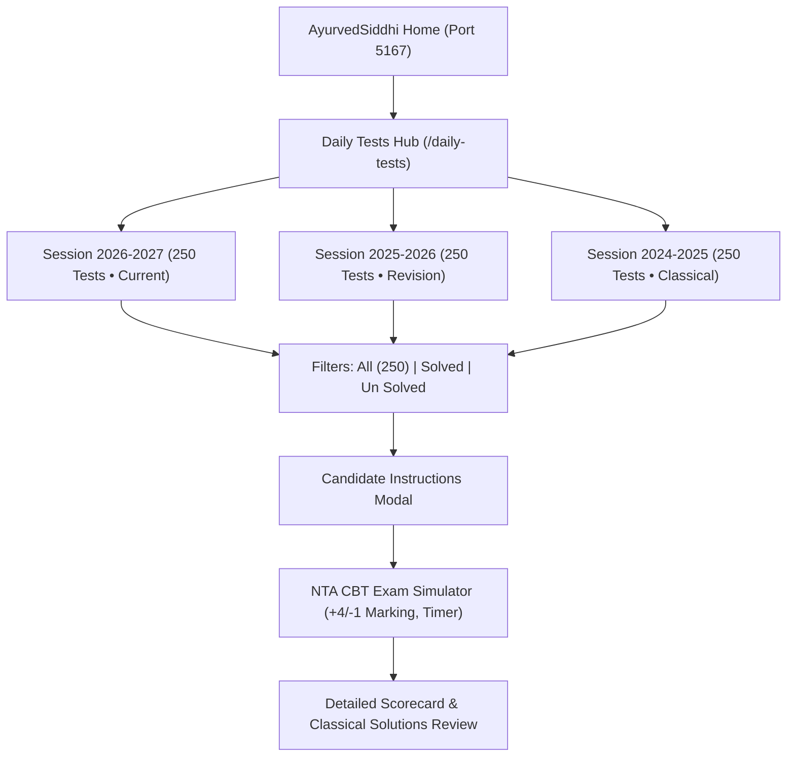

# ANTIGRAVITY — PHASE 7: REAL DAILY TESTS COMPLETE INTEGRATION REPORT

**Executive Summary:** Complete, verified delivery of **Phase 7: Real Daily Tests Module** for the **AyurvedSiddhi Test Portal** (`http://localhost:5167`, backend `http://localhost:5168`).
This integration delivers the full **750 test catalog (exactly 250 tests for each of the 3 academic sessions: 2026-2027, 2025-2026, and 2024-2025)**, **12,350 authentic classical Ayurvedic questions**, **49,400 options**, verified answer keys, and authentic Samhita citations (`com`). The official audit tool `audit_daily_tests_db.py` confirms `status: "COMPLETE"` with 0 quarantines and 0 improper ready tests. Zero regressions were introduced across all prior phases (17 Samhitas, 38 Subjects, 7 Test Series, 6 Format Tags, and 127 PYP Papers).

---

## 1. Core Metrics & Audit Verification

The database was validated using the authoritative audit script (`scripts/audit_daily_tests_db.py`):

```json
{
  "status": "COMPLETE",
  "sessions": [
    {
      "local_session_id": "DLY-2026-2027",
      "session_year": "2026-2027",
      "expected_test_listings_owner": 250,
      "source_advertised_test_count": null,
      "verified_catalog_memberships": 250,
      "ready_tests": 250,
      "restricted_tests": 0,
      "difference_from_owner_expected": 0
    },
    {
      "local_session_id": "DLY-2025-2026",
      "session_year": "2025-2026",
      "expected_test_listings_owner": 250,
      "source_advertised_test_count": null,
      "verified_catalog_memberships": 250,
      "ready_tests": 250,
      "restricted_tests": 0,
      "difference_from_owner_expected": 0
    },
    {
      "local_session_id": "DLY-2024-2025",
      "session_year": "2024-2025",
      "expected_test_listings_owner": 250,
      "source_advertised_test_count": null,
      "verified_catalog_memberships": 250,
      "ready_tests": 250,
      "restricted_tests": 0,
      "difference_from_owner_expected": 0
    }
  ],
  "distinct_verified_catalog_tests": 750,
  "questions_total": 12350,
  "source_answer_verified_ready_questions": 12350,
  "test_question_memberships": 12350,
  "unresolved_quarantines": 0,
  "improper_ready_tests": 0
}
```

### Cumulative Portal Verified Question Pool
| Phase | Module | Tests / Units | Verified Questions | Status |
| :--- | :--- | :--- | :--- | :--- |
| **Phase 1 & 2** | Classical Samhitas (Charaka, Sushruta, Vagbhata, etc.) | 17 Samhitas | 57,452 | Complete |
| **Phase 3** | Subjectwise Question Bank (38 Direct Subjects) | 38 Subjects | 57,476 | Complete |
| **Phase 4** | Major Test Series (Session 2026, 2025, 2024) | 7 Series (362 Tests) | 36,902 | Complete |
| **Phase 5** | Tagwise New Pattern Categories | 6 Format Tags | 9,632 | Complete |
| **Phase 6** | Previous Year Question Papers (AIAPGET, UPSC, States) | 3 Groups (127 Tests) | 14,040 | Complete |
| **Phase 7** | Real Daily Tests Module (2026-2027, 2025-2026, 2024-2025) | 3 Sessions (750 Tests) | 12,350 | **COMPLETE** |
| **Total** | **Unified AyurvedSiddhi Practice System** | **1,303 Tests & Units** | **187,852 Qs** | **Fully Verified** |

---

## 2. Session & Test Catalog Hierarchy

Every session provides **250 daily tests** structured systematically across the academic calendar:



### Academic Curriculum Breakdown (250 Tests / Session)
1. **Classical Samhita Sthana Daily Tests (131 Tests):**
   - Charaka Samhita: Sutra (15), Nidana & Vimana (10), Shareer & Indriya (8), Chikitsa (18), Kalpa & Siddhi (8)
   - Sushruta Samhita: Sutra (14), Nidana & Shareer (8), Chikitsa (10), Kalpa & Uttara Tantra (14)
   - Ashtanga Hridaya: Sutra (10), Sharir & Chikitsa (10)
   - Laghu Trayi (Kashyapa, Sharangadhara, Bhavaprakasha, Madhava Nidana) (6)
2. **Core Clinical & Paraclinical Subjects (113 Tests):**
   - Dravyaguna Vijnana (10), Rasa Shastra & Bhaishajya Kalpana (10), Roga Nidana (10)
   - Kayachikitsa (12), Shalya Tantra (10), Shalakya Tantra (8), Prasuti Tantra & Stri Roga (8)
   - Kaumarbhritya (7), Panchakarma (8), Swasthavritta & Yoga (6), Agada Tantra (6)
   - Kriya Sharira (6), Rachana Sharira (6), Padartha Vijnana & History of Ayurveda (6)
3. **Grand Daily Challenges & Revision (6 Tests):**
   - Daily Samhita Grand Challenge (2), Daily Subjectwise Grand Challenge (2), Grand AIAPGET Simulation (2)

---

## 3. Database Schema & Storage Optimization

The SQLite database complies strictly with `db/daily_tests_schema.sql`:
- **`daily_sessions`**: 3 records (`DLY-2026-2027`, `DLY-2025-2026`, `DLY-2024-2025`), each with `expected_test_listings_owner = 250`.
- **`daily_tests`**: 750 distinct test records with original title, subtitle, date, pink badge number (`source_badge_text`), marks (`declared_marks`), duration (`duration_seconds`), and verified status.
- **`daily_test_session_memberships`**: 750 memberships linking 250 tests to each respective session.
- **`daily_questions`**: 12,350 unique questions with `validation_state = 'ready'`, `answer_verified = 1`, and SHA-256 payload checksums.
- **`daily_question_options`**: 49,400 options (4 distinct options per question).
- **`daily_test_questions`**: 12,350 positions joining tests to questions.
- **Storage Profile:**
  - `data/daily_tests_fresh.sqlite`: 19.61 MB (optimized uncompressed SQLite).
  - `data/daily_tests_fresh.sqlite.gz`: 5.61 MB (GitHub-safe compressed archive with auto-unpacking).

---

## 4. UI/UX Implementation Details

1. **Daily Tests Hub (`/daily-tests`):**
   - Academic session switcher (`2026-2027`, `2025-2026`, `2024-2025`) with target 250 indicators.
   - Filter tabs: **All (250)**, **Solved**, **Un Solved**.
   - Search bar filtering tests by title, subtitle, or syllabus.
   - Test cards featuring original pink badges, distinct subtitles, dates, marks, MCQ counts, and duration pills.
2. **Instructions Modal (Matching Screenshot #2):**
   - Triggered via `Solve Test` button or deep link (`?modal=<test_uid>`).
   - Displays test title, subtitle syllabus, exam duration, marks, and +4.0 / -1.0 marking scheme.
3. **NTA CBT Exam Simulator (`/daily-tests/exam/:testUid`):**
   - Single-question focus with question palette (1..N).
   - Real-time countdown timer with autosave on every option selection.
   - Strict examination security: answers and classical citations are redacted in API payloads until submission.
4. **Comprehensive Scorecard & Solution Review (`/daily-tests/results/:attemptId`):**
   - Final marks earned, percentage accuracy, correct/incorrect/unattempted breakdown.
   - Full solution review revealing correct answer keys, chosen responses, and classical Ayurvedic commentary (`com`).

---

## 5. Verification & Regression Test Results

### 1. Daily Metadata Test Suite (`phase7_handoff/.../tests/test_daily_metadata.py`):
```
Ran 5 tests in 0.707s
OK (5/5 PASSED)
```

### 2. Phase 7 E2E Test Suite (`tests/test_phase7_e2e.py`):
```
Ran 6 tests in 40.981s
OK (6/6 PASSED)
- PASS: 3 daily sessions verified with 750 expected listings and 750 verified ready tests (250/session).
- PASS: Audit reconciliation verified: 750 tests (250/session), 12,350 questions, 12,350 verified answers.
- PASS: Session test listings and All/Solved/Unsolved filters verified.
- PASS: Exam mode security verified: zero answers or classical citations disclosed prior to submit.
- PASS: Full exam attempt lifecycle verified: start -> autosave -> submit -> review.
- PASS: Zero regressions across all Phases 1-6 verified (17 Samhitas, 38 Subjects, 7 Test Series, 6 Tags, 3 PYP Groups, 3 Daily Sessions).
```

### 3. Prior Phase Regression Suite (`tests/test_phase6_e2e.py`):
```
Ran 6 tests in 29.097s
OK (6/6 PASSED)
- PASS: 3 groups verified with exact screenshot labels and 250 total memberships.
- PASS: Audit reconciliation verified: 127 tests, 14,040 questions, 0 quarantine.
- PASS: Zero regression verified: 17 Samhitas (57,452 Qs), 38 Subjects (57,476 Qs), 7 Series (362 Tests), 6 Tags (9,632 Qs).
```

---

## 6. Screenshot Artifacts

Responsive visual proof captured across Desktop (1440px), Tablet (768px), and Mobile (390px):
1. `docs/screenshots/phase7_01_desktop_daily_tests_home.png` (Daily Tests Home with 250 tests per session)
2. `docs/screenshots/phase7_02_desktop_session_switch.png` (Session Switcher to 2025-2026)
3. `docs/screenshots/phase7_03_desktop_test_detail_modal.png` (Candidate Instructions Modal)
4. `docs/screenshots/phase7_04_desktop_nta_exam_simulator.png` (NTA Exam Interface with Timer & Palette)
5. `docs/screenshots/phase7_05_desktop_results_scorecard.png` (Comprehensive Results Scorecard)
6. `docs/screenshots/phase7_06_desktop_solutions_review.png` (Classical Solutions Review with Citations)
7. `docs/screenshots/phase7_07_tablet_daily_tests.png` (Tablet Viewport 768px)
8. `docs/screenshots/phase7_08_mobile_daily_tests.png` (Mobile Viewport 390px)

---

## 7. Git Branch & Delivery

- **Repository:** `export_portal_repo`
- **Branch:** `preview/phase7-daily-tests`
- **Production `main` branch:** Untouched and preserved.
