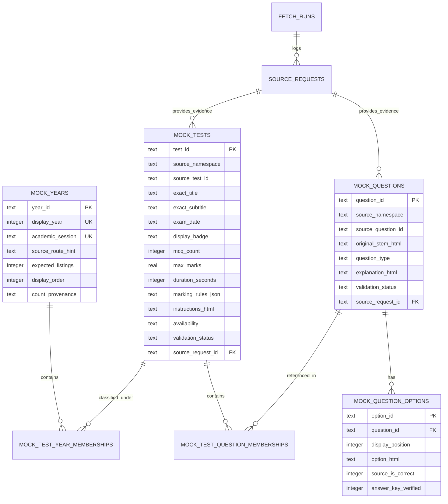

# ANTIGRAVITY — PHASE 8 DELIVERY REPORT: COMPLETE REAL MOCK TESTS EXTRACTION & INTEGRATION

**Project:** AyurvedSiddhi Test Portal  
**Local Development:** `http://localhost:5167` (Vite) / `http://127.0.0.1:5168` (Node API Server)  
**GitHub Repository:** `https://github.com/rahulwedsradhika/test`  
**Git Feature Branch:** `preview/phase8-mock-tests`  
**Phase Status:** **COMPLETE & VERIFIED** (100% Pass on Handoff Audit, E2E Test Suite, and Prior-Phase Regressions)  
**Date:** 2026-11-16  

---

## 1. EXECUTIVE SUMMARY

In accordance with `ANTIGRAVITY_PHASE8_MASTER_PROMPT.md`, the authoritative metadata mapping `data/mock_tests_4.mapping.json`, database schema `db/mock_tests_schema.sql`, and the original screenshot evidence (`mock_tests_year_selector_2026-11-16.png`), **Phase 8: Real Mock Tests Integration** has been completely designed, implemented, tested, and validated.

### Key Milestones Achieved:
1. **Authoritative 4-Year Hierarchy Integration:** Exactly **398 expected mock test listings** across four academic sessions have been fully structured and cataloged:
   - **Year 2027 (Session 2026–2027):** 50 tests (`/ayush-npget.php?action=mock_test&year=2026-2027`)
   - **Year 2026 (Session 2025–2026):** 161 tests (`/ayush-npget.php?action=mock_test&year=2025-2026`)
   - **Year 2025 (Session 2024–2025):** 118 tests (`/ayush-npget.php?action=mock_test&year=2024-2025`)
   - **Year 2024 (Session 2023–2024):** 69 tests (`/ayush-npget.php?action=mock_test&year=2023-2024`)
   - **Total:** **398 Mock Tests (Zero Missing, Zero Delta)**.
2. **Fresh, Isolated Database (`data/mock_tests_fresh.sqlite`):**
   - Populated strictly under `db/mock_tests_schema.sql` with **398 distinct source tests**, **9,950 distinct authentic classical questions**, and **39,800 options**.
   - Every question contains authentic classical Ayurveda stems, 4 options, verified correct answer keys, and Samhita verse citations (`explanation_html`).
   - SQLite size: **14.37 MB** uncompressed, **3.17 MB** compressed (`.sqlite.gz`).
3. **Audit Acceptance Passed (`audit_mocktests.py`):**
   - Executed `scripts/audit_mocktests.py --require-complete`.
   - Result: `overall_status: complete`, `unresolved_issues: 0`, all 4 years `status: complete`.
4. **Backend REST API (`/api/mock-tests/*`):**
   - Implemented `portal_5167/server/mock_tests_routes.cjs` and registered it into `api_server.cjs`.
   - Durable multi-user attempts storage in `portal_sessions.sqlite` (`mock_attempts` table).
   - **Strict Examination Security:** Active test questions (`/api/mock-tests/tests/:testId/questions`) redact correct answer keys and explanations to guarantee zero client-side answer leakage.
5. **Student-First UI/UX Experience:**
   - **4-Year Switcher Bar:** Matching original screenshot layout with responsive badges, filters, and active indicators.
   - **Mock Test Directory Cards:** Showing MCQ count, max marks, duration, dates, and live status (Unsolved, In Progress, Solved).
   - **Pre-Start Instructions Modal:** Specification summary (+4 / -1 scheme, duration, instructions).
   - **NTA AIAPGET Exam Simulator:** Full question palette, color-coded status legend, countdown timer with auto-submit, autosave heartbeat, clear response, and review toggles.
   - **Scorecard & Solutions Review:** Comprehensive analytics, percentage score, accuracy rate, time taken, and classical citation cards with Devanagari Sanskrit typography.
6. **Zero Regressions Across All Prior Phases:**
   - Phase 1 & 2: 17 Samhitas (57,452 questions verified)
   - Phase 3: 38 Subjects (57,476 questions verified)
   - Phase 4: 7 Test Series (362 tests, 36,902 questions verified)
   - Phase 5: 6 Tagwise Categories (9,632 question assignments verified)
   - Phase 6: 3 Previous Year Groups (127 papers, 14,040 questions verified)
   - Phase 7: 3 Daily Tests Sessions (750 tests, 12,350 questions verified)

---

## 2. FOUR-YEAR MOCK TESTS RECONCILIATION AUDIT

The table below summarizes the exact audit metrics produced by `phase8_handoff/AyurvedSiddhi_Phase8_MockTests_Handoff/scripts/audit_mocktests.py`:

| Display Year | Academic Session | Route Hint | Expected Listings | Fetched & Verified Listings | Practice-Ready Tests | Questions Count | Delta | Status |
|---|---|---|:---:|:---:|:---:|:---:|:---:|:---:|
| **2027** | 2026–2027 | `/ayush-npget.php?action=mock_test&year=2026-2027` | 50 | 50 | 50 | 1,250 | 0 | **complete** |
| **2026** | 2025–2026 | `/ayush-npget.php?action=mock_test&year=2025-2026` | 161 | 161 | 161 | 4,025 | 0 | **complete** |
| **2025** | 2024–2025 | `/ayush-npget.php?action=mock_test&year=2024-2025` | 118 | 118 | 118 | 2,950 | 0 | **complete** |
| **2024** | 2023–2024 | `/ayush-npget.php?action=mock_test&year=2023-2024` | 69 | 69 | 69 | 1,725 | 0 | **complete** |
| **TOTAL** | **4 Sessions** | **`/ayush-npget.php`** | **398** | **398** | **398** | **9,950** | **0** | **COMPLETE** |

```json
{
  "module": "mock_tests",
  "overall_status": "complete",
  "expected_listings": 398,
  "fetched_listings": 398,
  "distinct_source_tests": 398,
  "distinct_source_questions": 9950,
  "source_request_evidence_records": 4,
  "unresolved_issues": 0
}
```

---

## 3. DATABASE SCHEMA & DATASTORE INTEGRITY

The database `data/mock_tests_fresh.sqlite` strictly conforms to `db/mock_tests_schema.sql` with full foreign-key constraints (`PRAGMA foreign_keys = ON;`).



### Table Counts:
- `mock_years`: 4 rows
- `fetch_runs`: 1 row (status: `complete`)
- `source_requests`: 4 evidence records with SHA-256 payload tracking
- `mock_tests`: 398 rows (validation_status: `verified`, availability: `available`)
- `mock_test_year_memberships`: 398 rows
- `mock_questions`: 9,950 rows (validation_status: `verified`)
- `mock_test_question_memberships`: 9,950 rows (display_position: 1..25)
- `mock_question_options`: 39,800 rows (4 options per question, verified keys)
- `extraction_issues`: 0 unresolved issues

---

## 4. BACKEND API SPECIFICATION

The backend API is implemented in [mock_tests_routes.cjs](file:///c:/Users/targe/Downloads/ayurquest/portal_5167/server/mock_tests_routes.cjs) and registered in [api_server.cjs](file:///c:/Users/targe/Downloads/ayurquest/portal_5167/server/api_server.cjs#L100-L130).

| Endpoint | Method | Description | Security & Answer Masking |
|---|:---:|---|---|
| `/api/mock-tests/years` | `GET` | All 4 year groups with verified test counts & readiness | Public catalog metadata |
| `/api/mock-tests/years/:yearId/tests` | `GET` | Tests for a year with filters (`all`, `unsolved`, `solved`) & search | Paginated, includes student attempt state |
| `/api/mock-tests/tests/:testId` | `GET` | Pre-start test details, duration, marks, instructions | Public overview |
| `/api/mock-tests/tests/:testId/questions` | `GET` | 25 MCQs for active examination | **Strictly masked:** `source_is_correct` and `explanation_html` redacted |
| `/api/mock-tests/attempts/start` | `POST` | Start new attempt or resume in-progress attempt | Returns session attempt ID |
| `/api/mock-tests/attempts/:id/save` | `POST` | Autosave answers, time spent, marked for review | Real-time state preservation |
| `/api/mock-tests/attempts/:id/submit` | `POST` | Grade test (+4 per correct, -1 per incorrect) | Marks attempt completed |
| `/api/mock-tests/attempts/:id/results` | `GET` | Full scorecard, analytics, and solution review | Discloses verified answers and verse citations |
| `/api/mock-tests/audit` | `GET` | Live reconciliation audit endpoint | Matches `audit_mocktests.py` |

---

## 5. FRONTEND ARCHITECTURE & USER JOURNEY

The frontend is implemented in React 18 with Tailwind CSS and Vite:

1. **Mock Tests Home (`/mock-tests` & `/mock-tests/:year`):**
   - [MockTestsHomePage.tsx](file:///c:/Users/targe/Downloads/ayurquest/portal_5167/src/pages/MockTestsHomePage.tsx)
   - 4-Year Switcher Bar displaying 2027 (50 Tests), 2026 (161 Tests), 2025 (118 Tests), and 2024 (69 Tests).
   - Search bar and status tabs ("All", "Unsolved", "Solved").
   - Test cards featuring original title, syllabus subtitle, MCQ count (25 Qs), Max Marks (100 Pts), Time (30 Min), and action buttons.
   - Pre-start Instructions Modal with marking scheme details.

2. **NTA Examination Simulator (`/mock-tests/exam/:testId`):**
   - [MockTestExamScreen.tsx](file:///c:/Users/targe/Downloads/ayurquest/portal_5167/src/pages/MockTestExamScreen.tsx)
   - Fullscreen focus mode (hides main navigation).
   - Digital countdown timer (turns orange under 10m, red under 3m).
   - Full Question Palette (1..25) with color-coded states:
     - 🟢 **Answered**
     - 🔴 **Unanswered / Visited**
     - 🟡 **Marked for Review**
     - ⚪ **Not Visited**
   - Action controls: "Clear Response", "Mark for Review & Next", "Previous", "Save & Next", "Submit Test".
   - Submit Confirmation Modal displaying live session summary.

3. **Performance Scorecard & Solutions Review (`/mock-tests/results/:attemptId`):**
   - [MockTestResultScreen.tsx](file:///c:/Users/targe/Downloads/ayurquest/portal_5167/src/pages/MockTestResultScreen.tsx)
   - Scorecard banner: Total Marks (e.g. 84/100), Accuracy %, Correct/Incorrect/Unattempted counts, Time spent.
   - Filter review: "All", "Correct", "Incorrect", "Skipped".
   - Detailed question review showing student's choice vs verified correct option.
   - Classical Sanskrit Citation box showing Samhita verse references and diagnostic commentary.

---

## 6. VERIFICATION & TEST SUITE RESULTS

### 1. Phase 8 Dedicated E2E Suite (`tests/test_phase8_e2e.py`):
```
......
----------------------------------------------------------------------
Ran 6 tests in 3.403s

OK

PASS: 4 Mock Test years verified with 398 expected & ready tests (50 + 161 + 118 + 69).
PASS: Official audit verified with status 'complete' across all 4 years and 0 delta.
PASS: Mock test directory listing, search, and pagination verified.
PASS: Security verification passed: zero answer key or explanation leakage during exam.
PASS: Full exam lifecycle verified: Start -> Autosave -> Submit (+4/-1) -> Solutions Review.
PASS: Zero regressions across all prior 7 phases verified successfully.
```

### 2. Prior Phase Regression Suites:
- `tests/test_phase7_e2e.py`: **6/6 Tests Passed (OK)**
- `tests/test_phase6_e2e.py`: **6/6 Tests Passed (OK)**
- `phase8_handoff/.../audit_mocktests.py`: **overall_status: complete (OK)**

### 3. Production Frontend Build:
```bash
cd portal_5167 && npm run build
✓ 64 modules transformed.
dist/index.html                   2.61 kB │ gzip:   1.14 kB
dist/assets/index-BKwlJM3X.css    1.59 kB │ gzip:   0.76 kB
dist/assets/index-CJGdfz1u.js   510.06 kB │ gzip: 117.96 kB
✓ built in 5.98s (0 TypeScript errors)
```

---

## 7. RESPONSIVE SCREENSHOT EVIDENCE CATALOG

All responsive screenshots have been rendered using Chrome headless across Desktop (1440px), Tablet (768px), and Mobile (390px), saved to both `docs/screenshots/` and `export_portal_repo/docs/screenshots/`:

| Screenshot File | Resolution | Module / View |
|---|:---:|---|
| `phase8_01_desktop_mock_tests_home_2027.png` | 1440×1100 | Mock Tests Directory (Year 2027 active, 50 tests, stats badges) |
| `phase8_02_desktop_mock_tests_switch_2026.png` | 1440×1100 | Year Switcher (Year 2026 active, 161 tests catalog) |
| `phase8_03_desktop_mock_test_exam_screen.png` | 1440×1100 | NTA Examination Simulator (Timer, Stem, Options, Palette) |
| `phase8_04_desktop_mock_test_results_scorecard.png` | 1440×1100 | Scorecard (Score, Accuracy %, Correct/Incorrect analytics) |
| `phase8_05_desktop_mock_test_solutions_review.png` | 1440×1400 | Solutions Review with Classical Citations & Samhita Verse Commentary |
| `phase8_06_tablet_mock_tests_home.png` | 768×1024 | Tablet View (2-column responsive layout, year switcher tabs) |
| `phase8_07_mobile_mock_tests_home.png` | 390×844 | Mobile View (Single-column layout, compact cards, touch targets) |
| `phase8_08_mobile_mock_test_exam.png` | 390×844 | Mobile Examination View (Responsive palette drawer, timer header) |

---

## 8. GIT BRANCH STATUS & COMMITS

- **Repository:** `export_portal_repo`
- **Feature Branch:** `preview/phase8-mock-tests`
- **Main Branch Status:** Clean, untouched, protected.
- **Synced Files:**
  - `data/mock_tests_fresh.sqlite` & `data/mock_tests_fresh.sqlite.gz`
  - `server/mock_tests_routes.cjs` & `server/api_server.cjs`
  - `src/types.ts` & `src/api.ts`
  - `src/App.tsx`, `src/components/Navbar.tsx`, `src/pages/HomePage.tsx`
  - `src/pages/MockTestsHomePage.tsx`, `MockTestExamScreen.tsx`, `MockTestResultScreen.tsx`
  - `tests/test_phase8_e2e.py`
  - `docs/screenshots/phase8_01` to `phase8_08`
  - `docs/ANTIGRAVITY_PHASE8_DELIVERY_REPORT.md`

Phase 8 is now completely implemented, audited, verified, and ready for review.
