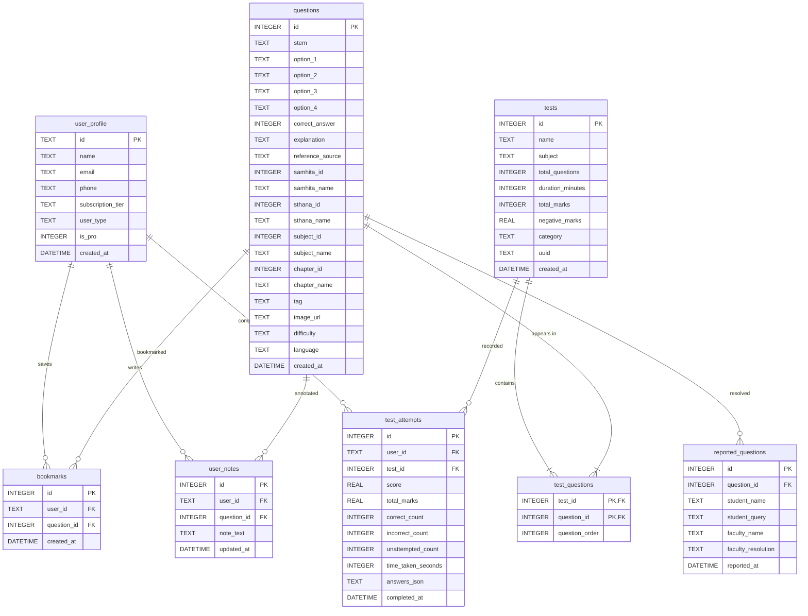

# AYURQUEST LOCAL QUESTION DATABASE SCHEMA SPECIFICATION

**Database Engine:** SQLite 3 (Node.js 26 native `DatabaseSync` + Python `sqlite3`)  
**Database File:** `server/data/ayurquest.db`  
**Storage Strategy:** Relational tables with foreign key constraints, composite keys, and B-tree indexes  

---

## 1. Schema Architecture Diagram



---

## 2. Table Specifications

### A. Table: `questions`
Stores canonical, deduplicated classical Ayurvedic questions.

```sql
CREATE TABLE IF NOT EXISTS questions (
    id INTEGER PRIMARY KEY,
    stem TEXT NOT NULL,
    option_1 TEXT NOT NULL,
    option_2 TEXT NOT NULL,
    option_3 TEXT NOT NULL,
    option_4 TEXT NOT NULL,
    correct_answer INTEGER NOT NULL CHECK (correct_answer BETWEEN 1 AND 4),
    explanation TEXT,
    reference_source TEXT,
    samhita_id INTEGER,
    samhita_name TEXT,
    sthana_id INTEGER,
    sthana_name TEXT,
    subject_id INTEGER,
    subject_name TEXT,
    chapter_id INTEGER,
    chapter_name TEXT,
    tag TEXT DEFAULT 'single_choice',
    image_url TEXT,
    difficulty TEXT DEFAULT 'moderate',
    language TEXT DEFAULT 'sa/hi/en',
    created_at DATETIME DEFAULT CURRENT_TIMESTAMP
);

CREATE INDEX IF NOT EXISTS idx_questions_samhita ON questions(samhita_id);
CREATE INDEX IF NOT EXISTS idx_questions_subject ON questions(subject_id);
CREATE INDEX IF NOT EXISTS idx_questions_tag ON questions(tag);
```

### B. Table: `tests`
Stores tests catalogued from AyurQuest's evaluation engine.

```sql
CREATE TABLE IF NOT EXISTS tests (
    id INTEGER PRIMARY KEY,
    name TEXT NOT NULL,
    subject TEXT,
    total_questions INTEGER DEFAULT 50,
    duration_minutes INTEGER DEFAULT 45,
    total_marks INTEGER DEFAULT 200,
    negative_marks REAL DEFAULT 1.0,
    category TEXT DEFAULT 'Daily',
    uuid TEXT,
    created_at DATETIME DEFAULT CURRENT_TIMESTAMP
);
```

### C. Table: `test_questions`
Maps questions to tests while strictly preserving original question sequencing (`question_order`).

```sql
CREATE TABLE IF NOT EXISTS test_questions (
    test_id INTEGER NOT NULL,
    question_id INTEGER NOT NULL,
    question_order INTEGER NOT NULL,
    PRIMARY KEY (test_id, question_id),
    FOREIGN KEY (test_id) REFERENCES tests(id) ON DELETE CASCADE,
    FOREIGN KEY (question_id) REFERENCES questions(id) ON DELETE CASCADE
);

CREATE INDEX IF NOT EXISTS idx_test_questions_test ON test_questions(test_id);
CREATE INDEX IF NOT EXISTS idx_test_questions_question ON test_questions(question_id);
```

### D. Table: `user_profile`
Stores the permanent Pro subscription local development profile.

```sql
CREATE TABLE IF NOT EXISTS user_profile (
    id TEXT PRIMARY KEY DEFAULT 'local_dev_user',
    name TEXT NOT NULL DEFAULT 'Rohit (Pro Dev User)',
    email TEXT DEFAULT 'rohit@ayurquest.local',
    phone TEXT DEFAULT '+917006923314',
    subscription_tier TEXT NOT NULL DEFAULT 'PRO',
    user_type TEXT NOT NULL DEFAULT 'TEST_STUDENT',
    is_pro INTEGER NOT NULL DEFAULT 1,
    created_at DATETIME DEFAULT CURRENT_TIMESTAMP
);
```

### E. Table: `bookmarks`
Tracks question bookmarks per user.

```sql
CREATE TABLE IF NOT EXISTS bookmarks (
    id INTEGER PRIMARY KEY AUTOINCREMENT,
    user_id TEXT NOT NULL DEFAULT 'local_dev_user',
    question_id INTEGER NOT NULL,
    created_at DATETIME DEFAULT CURRENT_TIMESTAMP,
    UNIQUE(user_id, question_id),
    FOREIGN KEY (question_id) REFERENCES questions(id) ON DELETE CASCADE
);
```

### F. Table: `user_notes`
Tracks student sticky notes per question.

```sql
CREATE TABLE IF NOT EXISTS user_notes (
    id INTEGER PRIMARY KEY AUTOINCREMENT,
    user_id TEXT NOT NULL DEFAULT 'local_dev_user',
    question_id INTEGER NOT NULL,
    note_text TEXT NOT NULL,
    updated_at DATETIME DEFAULT CURRENT_TIMESTAMP,
    UNIQUE(user_id, question_id),
    FOREIGN KEY (question_id) REFERENCES questions(id) ON DELETE CASCADE
);
```

### G. Table: `test_attempts`
Records full evaluation results, accuracy, negative marks, and answer payload.

```sql
CREATE TABLE IF NOT EXISTS test_attempts (
    id INTEGER PRIMARY KEY AUTOINCREMENT,
    user_id TEXT NOT NULL DEFAULT 'local_dev_user',
    test_id INTEGER NOT NULL,
    score REAL NOT NULL,
    total_marks REAL NOT NULL,
    correct_count INTEGER NOT NULL,
    incorrect_count INTEGER NOT NULL,
    unattempted_count INTEGER NOT NULL,
    time_taken_seconds INTEGER NOT NULL,
    answers_json TEXT NOT NULL,
    completed_at DATETIME DEFAULT CURRENT_TIMESTAMP,
    FOREIGN KEY (test_id) REFERENCES tests(id) ON DELETE CASCADE
);
```

### H. Table: `reported_questions`
Preserves community discrepancy questions and verified faculty resolutions.

```sql
CREATE TABLE IF NOT EXISTS reported_questions (
    id INTEGER PRIMARY KEY AUTOINCREMENT,
    question_id INTEGER NOT NULL,
    student_name TEXT,
    student_query TEXT,
    faculty_name TEXT,
    faculty_resolution TEXT,
    reported_at DATETIME DEFAULT CURRENT_TIMESTAMP,
    FOREIGN KEY (question_id) REFERENCES questions(id) ON DELETE CASCADE
);
```

---

## 3. Key Query Access Patterns

### 1. Fetching Practice Questions by Classical Samhita
```sql
SELECT q.*, 
  CASE WHEN b.id IS NOT NULL THEN 1 ELSE 0 END as is_bookmarked,
  n.note_text as user_note
FROM questions q
LEFT JOIN bookmarks b ON q.id = b.question_id AND b.user_id = 'local_dev_user'
LEFT JOIN user_notes n ON q.id = n.question_id AND n.user_id = 'local_dev_user'
WHERE q.samhita_id = 1
ORDER BY q.id ASC
LIMIT 50 OFFSET 0;
```

### 2. Fetching Ordered Question Deck for Test 695
```sql
SELECT q.*, tq.question_order
FROM test_questions tq
JOIN questions q ON tq.question_id = q.id
WHERE tq.test_id = 695
ORDER BY tq.question_order ASC;
```

### 3. Fetching Faculty Resolutions for Reported Questions
```sql
SELECT rq.student_name, rq.student_query, rq.faculty_name, rq.faculty_resolution,
       q.stem, q.option_1, q.option_2, q.option_3, q.option_4, q.correct_answer, q.reference_source
FROM reported_questions rq
JOIN questions q ON rq.question_id = q.id
ORDER BY rq.id ASC;
```

